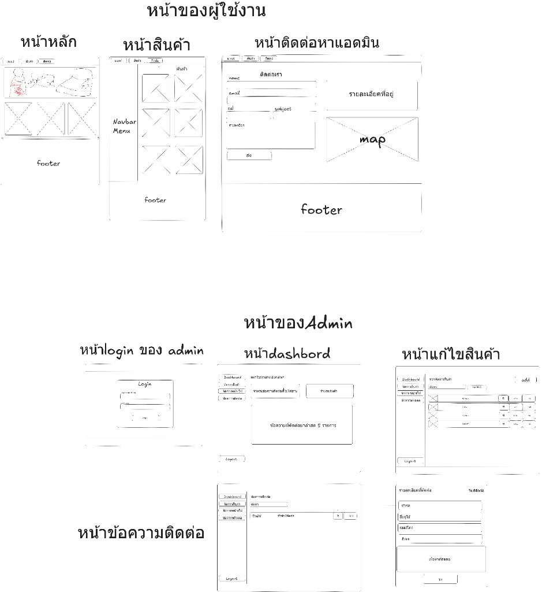

# 📋 สรุปข้อมูลธุรกิจและขอบเขตโครงการ (Website Brief)

เอกสารสรุปภาพรวมธุรกิจ วัตถุประสงค์ และขอบเขตการพัฒนาระบบเว็บไซต์ร้านค้าออนไลน์และระบบหลังบ้านสำหรับแบรนด์ **SADIDA**

---

## 🖼️ ภาพรวมโครงสร้างหน้าจอระบบ (Wireframe & Information Architecture)

ภาพจำลองโครงสร้างและเค้าโครงหน้าจอ (Wireframe Blueprint) ทั้งฝั่งผู้ใช้งานทั่วไป (User Storefront) และฝั่งผู้ดูแลระบบ (Admin Backoffice):

---

## 📌 ข้อมูลสรุปโครงการ (Project Information)

### • ชื่อโปรเจกต์ (Project Name)
 เว็ปไซต์โชว์สินค้ารองเท้า sadida

---

### • ภาพรวมตัวเว็บไซต์
ส่วนผู้ใช้สามารถ ดูสินค้า ค้นหาสินค้า ติดต่อหาแอดมิน
ส่วนเจ้าของเว็บสามารถ มีหน้าแดชบอร์ดดูสถานะของสินค้าที่มี ข้อความติดต่อ หมวดสินค้าที่มี เพิ่มสนค้า เพิ่มหมวดหมู่สินค้า เพิ่มหมวดสินค้า แก้ไขหน้าเว็บ ดูข้อความติดต่อ
---

### • วัตถุประสงค์ของเว็บไซต์ (Objective)
1. **สร้างการรับรู้แบรนด์ (Brand Awareness):** นำเสนอเอกลักษณ์ ปรัชญา และงานดีไซน์ของแบรนด์ Sadida ให้เป็นที่จดจำในฐานะแบรนด์รองเท้าโมโนโครมระดับสตูดิโอ
2. **เพิ่มช่องทางจัดแสดงและเลือกซื้อสินค้า (Digital Showroom):** ให้ลูกค้าสามารถเข้าชมแคตตาล็อกสินค้า ดูรายละเอียด เช็กราคา และเลือกดูขนาดรองเท้า (UK Size) ได้สะดวกรวดเร็ว
3. **ระบบจัดการหลังบ้านที่มีประสิทธิภาพ (Admin Operations):** ให้ผู้ดูแลระบบสามารถควบคุมข้อมูลสินค้า ปรับปรุงราคา อัปเดตไซส์ จัดการหมวดหมู่สินค้า ปรับเปลี่ยนแบนเนอร์หน้าร้าน และติดตามข้อความติดต่อจากลูกค้าได้อย่างครบวงจรผ่านจุดเดียว
4. **สร้างช่องทางสื่อสารระหว่างแบรนด์กับลูกค้า (Customer Communication):** เปิดรับข้อซักถาม คำแนะนำ หรือข้อร้องเรียนจากลูกค้าผ่านแบบฟอร์ม Contact Us พร้อมระบบบันทึกและแจ้งเตือนไปยังแอดมิน

---

### • กลุ่มเป้าหมาย (Target Audience)
1. **กลุ่มผู้ที่ชื่นชอบสไตล์มินิมอล (Minimalist & Streetwear Enthusiasts):** ชายและหญิงอายุ 18–40 ปี ที่หลงใหลในความเรียบเท่ ดีไซน์โทนสีดำ-ขาว (Monochrome Aesthetic) และการแต่งตัวที่เรียบหรูร่วมสมัย
2. **นักวิ่งและผู้รักสุขภาพ (Runners & Fitness Lovers):** ผู้ที่มองหารองเท้าวิ่งน้ำหนักเบา มีการซับแรงกระแทกที่ดี เพื่อใช้วิ่งออกกำลังกาย วิ่งมาราธอน หรือเทรนนิ่ง
3. **คนทำงานและคนเมือง (Urban Commuters):** บุคคลที่ต้องยืนหรือเดินเป็นเวลานานในชีวิตประจำวัน ต้องการรองเท้าเดินที่นุ่มสบาย ซัพพอร์ตข้อเท้าและฝ่าเท้า แต่ยังคงความภูมิฐานแมตช์ได้กับชุดทำงาน

---

### • ข้อความหลักที่ต้องการสื่อ (Key Message)
> **"CRAFTED FOR PURE MOTION."**  
> *จากภาพร่างสเก็ตช์ในสตูดิโอ สู่นวัตกรรมรองเท้าวิ่งและรองเท้าเดินที่เรียบหรูเหนือกาลเวลา*

**จุดยืนและปรัชญาของแบรนด์ (Brand Story):**  
"ทำไมต้องเป็นโทนสีดำกับสีขาวของ SADIDA? เพราะเราเชื่อในการตัดทอนสิ่งที่ไม่จำเป็น เพื่อให้ผู้สวมใส่สัมผัสกับโครงสร้างที่แท้จริงของรองเท้า ความประณีตในการตัดเย็บ และความสมดุลระหว่างฟังก์ชันการใช้งานกับแฟชั่นที่ไม่มีวันล้าสมัย"

---

### • ขอบเขตงาน (Scope of Work)

ตามโครงสร้างภาพจำลอง Wireframe ระบบแบ่งออกเป็น 2 ส่วนหลัก:

#### 1. ฝั่งผู้ใช้งานทั่วไป (User Storefront)
- **หน้าหลัก (Home Page):**
  - แบนเนอร์หลัก (Hero Banner) สื่อสารคอนเซปต์แบรนด์ พร้อมปุ่มกระตุ้นการตัดสินใจ (Call to Action)
  - แถบเลื่อนแสดงสินค้าไฮไลต์ (Product Carousel) รองรับการสไลด์ดูรองเท้ารุ่นยอดนิยม
  - ส่วนบอกเล่าเรื่องราวและปรัชญาของแบรนด์ (Brand Story & Features)
- **หน้าสินค้า (Products / Store Page):**
  - เมนูแท็บแถบนำทาง (Navbar Menu) สำหรับกรองหมวดหมู่สินค้า (เช่น ทั้งหมด, รองเท้าวิ่ง, รองเท้าเดิน)
  - ช่องค้นหาชื่อสินค้า (Search Box)
  - การ์ดสินค้าแสดงผลแบบ Grid Layout ที่มีความสูงสมดุลเท่ากันทุกการ์ด (Equal Height)
  - หน้าต่าง Modal รายละเอียดสินค้า: แสดงรูปภาพ, คำอธิบายจำกัด 3 บรรทัด, ราคา, ตัวเลือกไซส์รองเท้า (UK Size: 6.5 UK – 10.5 UK) และปุ่มสั่งซื้อจำลอง
- **หน้าติดต่อเรา (Contact Page):**
  - แบบฟอร์มติดต่อ (Contact Form): กรอกชื่อ, อีเมล, เบอร์โทรศัพท์, หัวข้อ และข้อความ (มีระบบตรวจสอบ Zod Validation)
  - ข้อมูลรายละเอียดที่อยู่ร้าน ข้อมูลการติดต่อ แผนที่จำลอง (Map Embed) และช่องทางโซเชียลมีเดีย

#### 2. ฝั่งผู้ดูแลระบบ (Admin Backoffice)
- **หน้าระบบเข้าสู่ระบบ (Admin Login):**
  - ตรวจสอบสิทธิ์ผู้ดูแลระบบด้วยชื่อผู้ใช้/เบอร์โทรศัพท์ และรหัสผ่านที่เข้ารหัสด้วย Bcrypt
- **หน้าแดชบอร์ด (Admin Dashboard):**
  - การ์ดสถิติแสดงผลแบบเรียลไทม์: จำนวนสินค้าทั้งหมด, จำนวนหมวดหมู่ทั้งหมด, และจำนวนข้อความติดต่อ
  - กล่องแสดงรายการข้อความติดต่อล่าสุด 5 รายการ
- **หน้าจัดการสินค้าและหมวดหมู่ (Admin Products & Categories):**
  - ตารางแสดงรายการสินค้า พร้อมฟังก์ชันค้นหาและกรอง
  - ฟังก์ชันเพิ่มสินค้าใหม่ (Add Product): ตั้งชื่อ, ใส่คำอธิบาย (มีระบบเตือนและนับบรรทัดไม่เกิน 3 บรรทัด), อัปโหลดรูปภาพ, เลือกหมวดหมู่, และเลือกขนาดรองเท้าพร้อมเรียงลำดับไซส์อัตโนมัติ
  - ฟังก์ชันแก้ไขสินค้า (Edit Product) และฟังก์ชันลบสินค้า (Delete Product)
  - ระบบจัดการหมวดหมู่ (Categories Modal): เพิ่มหมวดหมู่ใหม่ และป้องกันการลบหมวดหมู่ที่มีสินค้าผูกอยู่
- **หน้าจัดการกล่องข้อความติดต่อ (Admin Contacts Inbox):**
  - ตารางแสดงข้อความติดต่อจากลูกค้าทั้งหมด พร้อมวันเวลาที่ส่งเข้ามา
  - หน้าต่างดูรายละเอียดข้อความฉบับเต็ม และฟังก์ชันลบข้อความ
- **หน้าจัดการปรับแต่งเว็บไซต์ (Admin Website Customization):**
  - ปรับแต่งข้อความแบนเนอร์ และอัปโหลดเปลี่ยนภาพแบนเนอร์หลักของหน้าแรก

---

### • โทนสีและสไตล์ (Brand Vibe)

| องค์ประกอบ | รายละเอียดการออกแบบ |
| :--- | :--- |
| **แนวคิดการออกแบบ (Design Concept)** | **Minimalist, Monochrome, Studio Aesthetic & Modern Precision** |
| **คู่สีหลัก (Primary Palette)** | ⚫ **Jet Black (`#000000` / `#0F0F0F`):** สื่อถึงความหนักแน่น คมชัด พรีเมียม และความเด็ดเดี่ยว ⚪ **Pure White (`#FFFFFF`):** สื่อถึงความสะอาดตา ความบริสุทธิ์ และความเรียบง่ายเหนือกาลเวลา |
| **สีรองและสีพื้นผิว (Secondary / Surface)** | 🔘 **Light Gray & Charcoal (`#F4F4F5`, `#E4E4E7`, `#27272A`):** ใช้สำหรับเส้นขอบ (Borders), พื้นหลังการ์ด, และการแบ่งสัดส่วนเลย์เอาต์ |
| **สีเน้นสถานะ (Accents & Highlights)** | 🔴 **Subtle Red / Emerald (`#EF4444`, `#10B981`):** สำหรับป้าย Badge แจ้งเตือนข้อผิดพลาด และสถานะความสำเร็จ |
| **รูปแบบตัวอักษร (Typography)** | ฟอนต์สไตล์ Sans-Serif แบบ Modern Geometric มีความคมชัด อ่านง่ายทั้งภาษาไทยและภาษาอังกฤษ |
| **สไตล์ภาพถ่าย (Photography Style)** | ภาพถ่ายรองเท้าในสตูดิโอแบบ Clean Cut พื้นหลังขาวหรือคอนกรีตลอฟท์ ขับเน้นมิติ โครงสร้างผ้าตาข่าย และงานเย็บของรองเท้าอย่างชัดเจน |
