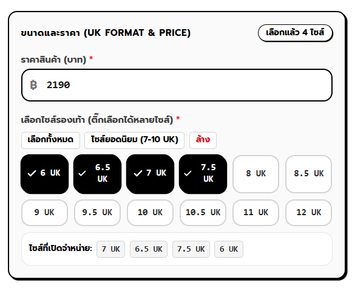

ระบบที่ต้องเพิ่ม
~~1. admin/website แก้ตรงการจัดการหน้าหลักให้สามารถอัปโหลดรูปมาเปลี่ยนรูปแบรนเนอร์หลักได้~~
~~2. จัดการหมวดหมู่ตรงหน้า admin/product ตรงไหนปุ่มเพิ่มหมวดหมู่หากแอดมินกดลบหมวดหมู่ที่มีรองเท้าอยู่ให้ขึ้นเตือนไว้ว่ามีสินค้าอยู่ในหมวดหมู่นี้อยู่ไม่สามารถลบได้~~
~~3. ตรงหน้า admin/product ตรงหน้าaddสินค้าตรงเลือกไซต์รองเท้า ตอนกดให้มันขึ้นเรียงหน่อย สมมุติ  หากกดไซต์ 7 แล้วไปกดไซต์ 6 ตรงไซต์ที่เปิดจำหน่ายมันไม่เรียงไซต์กันแก้มาหน่อย~~